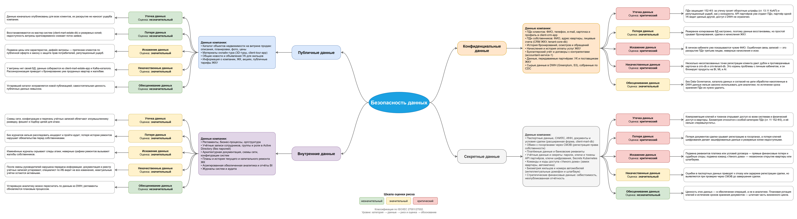

# Задание 1. Проверочный лист по безопасности данных (mindmap)

| Артефакт | draw.io | Изображение |
|---|---|---|
| Mindmap «Безопасность данных» | [data-security-mindmap.drawio](data-security-mindmap.drawio) | [data-security-mindmap.png](data-security-mindmap.png) |

Структура mindmap: центр «Безопасность данных» → категория данных (ISO/IEC 27001/27002) → данные компании этой категории → риск и его оценка → обоснование оценки.
Цвет блока риска соответствует оценке: зелёный — незначительный, жёлтый — значительный, красный — критический.

## Классификация данных

| Категория | Данные PropDevelopment |
|---|---|
| Публичные | Каталог объектов на витрине продаж (описания, планировки, фото, цены), материалы онлайн-тура, общие новости УК, информация о компании и ЖК, публичные тарифы ЖКУ |
| Внутренние | Регламенты и оргструктура, учётные записи и группы в Active Directory (без паролей), архитектурная документация и схемы сети, планы и история ремонтов, обезличенная аналитика BI, журналы систем и аудита |
| Конфиденциальные | ПДн клиентов и собственников (ФИО, контакты, адрес, лицевые счета), история бронирований и осмотров, начисления и оплаты ЖКУ, бухгалтерский учёт и договоры, данные для партнёров (УК, поставщики ЖКУ), сырые данные в DWH |
| Секретные | Паспортные данные, СНИЛС, ИНН и документы сделки, обмен с госорганами через СМЭВ, платёжные реквизиты, пароли, ключи, токены и секреты, коды доступа «Умного дома», биометрия и номера автомобилей, стратегические финансовые данные |

## Оценка рисков

| Риск | Публичные | Внутренние | Конфиденциальные | Секретные |
|---|---|---|---|---|
| Утечка данных | незначительный | значительный | **критический** | **критический** |
| Потеря данных | незначительный | значительный | значительный | **критический** |
| Искажение данных | значительный | значительный | **критический** | **критический** |
| Некачественные данные | значительный | значительный | **критический** | значительный |
| Обесценивание данных | незначительный | незначительный | значительный | незначительный |

Обоснование каждой оценки приведено на последнем уровне mindmap.

## Выводы
1. Самая уязвимая зона — **конфиденциальные данные (ПДн клиентов и собственников)**. Утечка через API партнёров и неограниченный доступ к DWH, искажение (чужие ФИО в личном кабинете) и низкое качество из-за нескольких точек регистрации прямо соответствуют проблемам компании.
2. **Секретные данные** (документы сделки, ключи и токены, коды «Умного дома», биометрия) требуют самых строгих мер: шифрования, управления секретами, минимальных привилегий и аудита доступа.
3. Для перехода к продуктам на BI, ML и AI нужен Data Governance: каталог и владельцы данных, единая точка регистрации клиента (MDM), разграничение доступа к DWH по классу данных и обезличивание.
