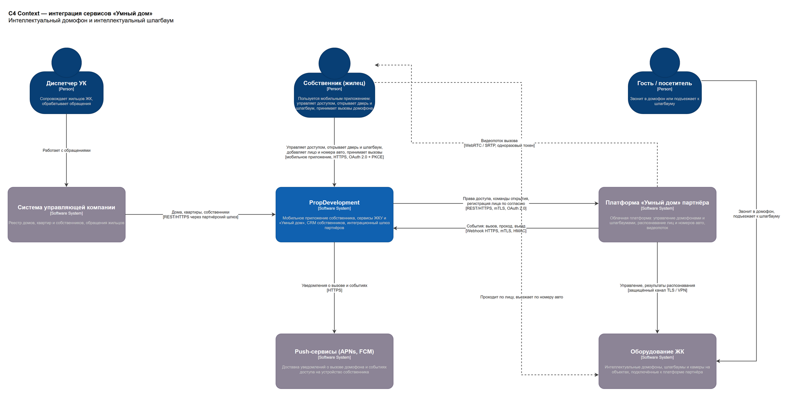
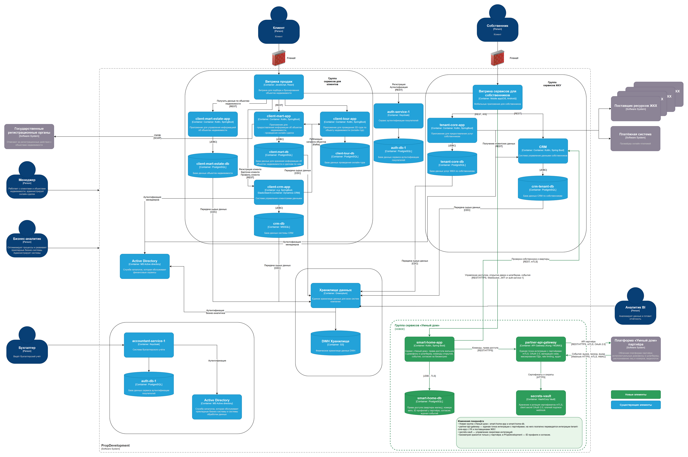

# Задание 3. Внешние интеграции: сервисы «Умный дом»

| Артефакт | draw.io | Изображение |
|---|---|---|
| Диаграмма контекста C4 | [c4-context.drawio](c4-context.drawio) | [c4-context.png](c4-context.png) |
| Обновлённая диаграмма контейнеров C4 | [c4-container.drawio](c4-container.drawio) | [c4-container.png](c4-container.png) |
| Требования к внешним интеграциям | [requirements.md](requirements.md) | — |

Новые бизнес-функции для собственников, которые предоставляет партнёр:
- **Интеллектуальный домофон**: открытие по звонку и автоматическое открытие двери при распознавании лица жильца, которому разрешён доступ.
- **Интеллектуальный шлагбаум**: классическое управление и автоматическое открытие при распознавании номера разрешённого автомобиля.

Обе функции доступны в текущем мобильном приложении собственника.

## Диаграмма контекста
Собственник управляет доступом через мобильное приложение PropDevelopment. PropDevelopment передаёт права доступа и команды на платформу партнёра и получает от неё события. Платформа партнёра управляет оборудованием ЖК: домофонами, шлагбаумами и камерами. Видеопоток вызова идёт напрямую с платформы партнёра в приложение по одноразовому токену, который выдаёт PropDevelopment. Реестр домов, квартир и собственников приходит из систем УК через партнёрский шлюз.

## Диаграмма контейнеров
Новые элементы выделены зелёным:
- **smart-home-app** (Kotlin, Spring Boot) — сервис «Умный дом»: права доступа жильцов, команды открытия, события, согласия на биометрию. Проверяет собственника и квартиру в CRM ЖКУ.
- **smart-home-db** (PostgreSQL) — права доступа, номера автомобилей, идентификаторы биометрических профилей у партнёра, согласия, журнал событий. Сами биометрические шаблоны в PropDevelopment не хранятся.
- **partner-api-gateway** — единая точка интеграции с внешними партнёрами: mTLS, OAuth 2.0, валидация контрактов, маскирование ПДн, rate limiting, аудит. На этот шлюз поэтапно переводятся и существующие интеграции tenant-core-app с УК и поставщиками ЖКУ, что закрывает проблему API партнёров.
- **secrets-vault** (HashiCorp Vault) — хранение и ротация сертификатов, client secret и ключей подписи webhook.
- **Платформа «Умный дом» партнёра** — внешняя система.

